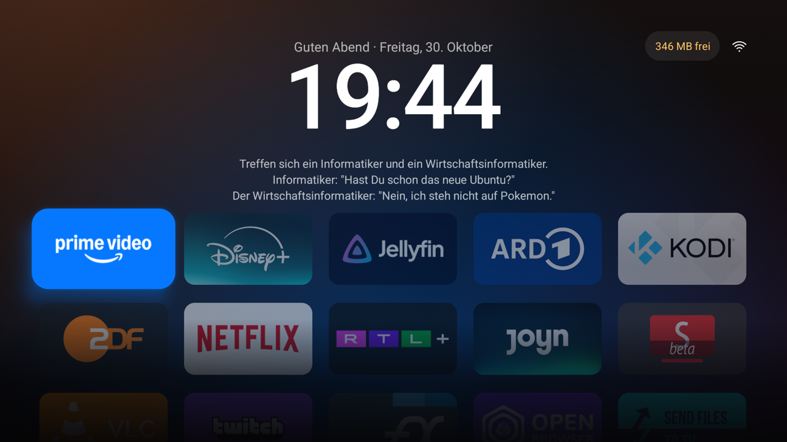
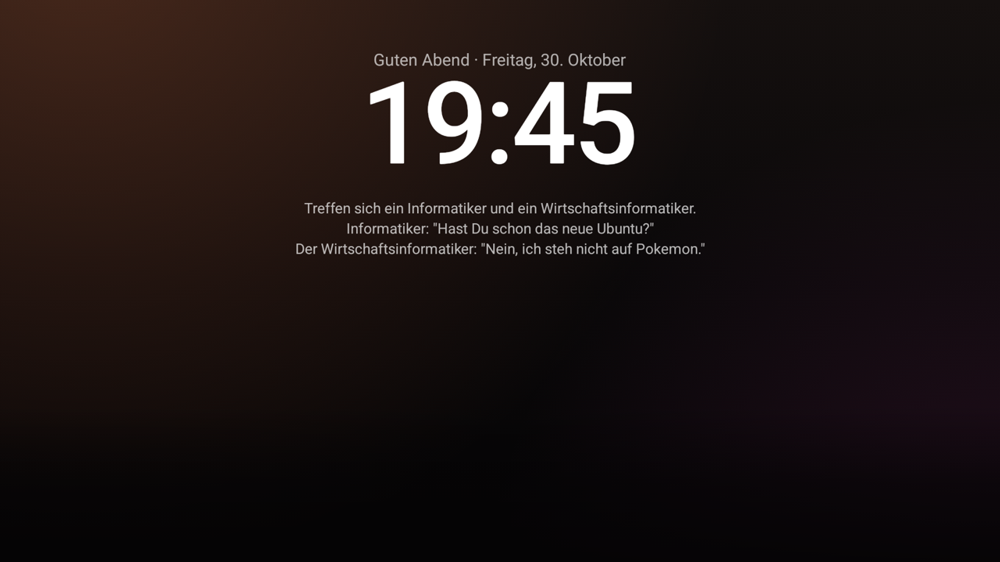
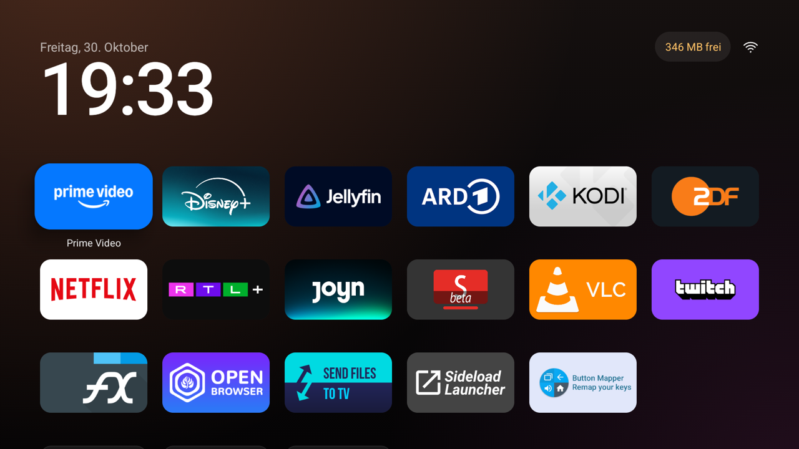
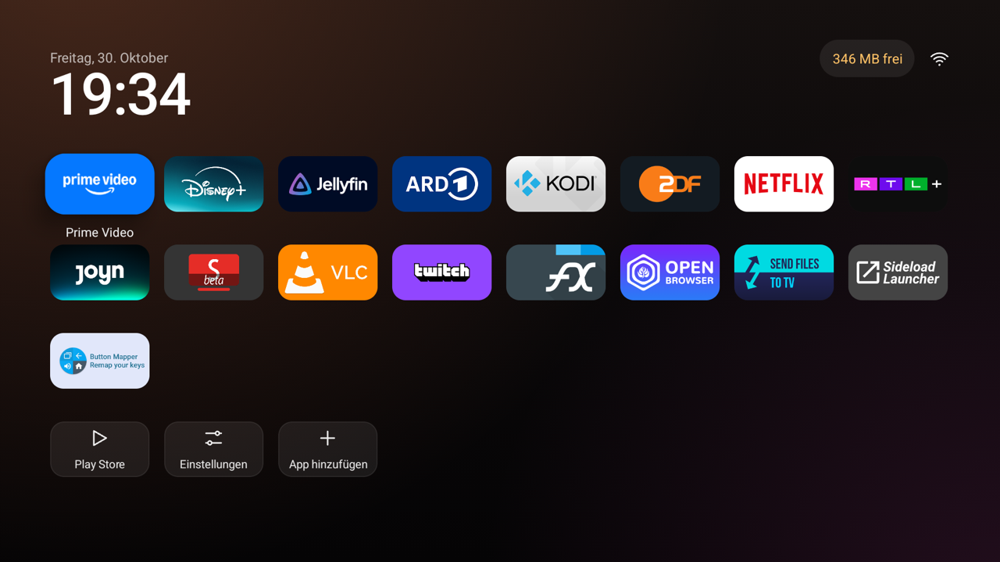
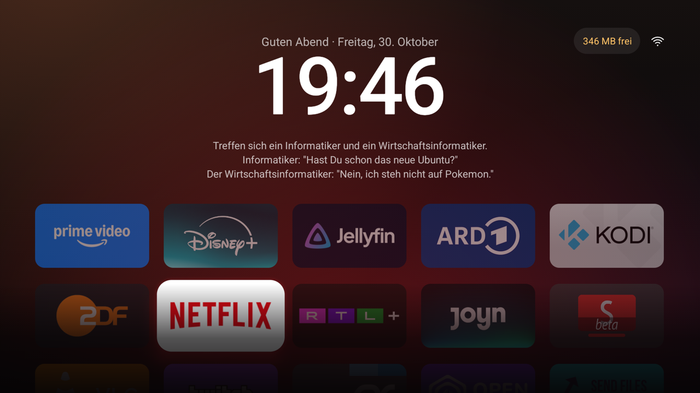
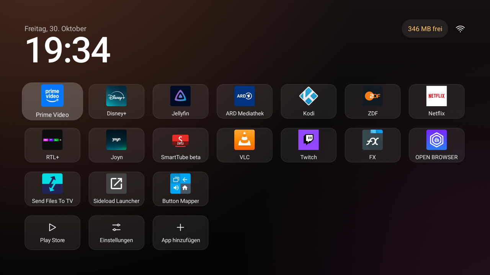

# tv-detox – Chromecast-Fork

Eigene Version von [Ansub/tv-detox](https://github.com/Ansub/tv-detox) (Basis: v1.5.7, `b22a1e3`) für einen
Chromecast mit Google TV (Android 14). Änderungen liegen auf dem Branch `chromecast-home`, `main` bleibt
gleich mit dem Original.

## Was anders ist

**Home-Taste (`HomeButton.java`)**
- Der Chromecast gibt die Home-Taste nie an Bedienungshilfen weiter: Google TV startet immer zuerst
  (per logcat belegt, `PhoneWindowManager$DisplayHomeButtonHandler`). Abfangen wie bei Plume geht hier nicht.
- Die Fernbedienung schickt pro Druck zwei bis drei Home-Befehle. Das Original legte sich nach dem ersten
  über Google TV und ignorierte die nächsten, sodass Google TV stehen blieb. Jetzt legt sich tv-detox sofort
  drüber und noch einmal, wenn weitere Home-Befehle nachkommen. Google TV ist ca. 0,3 s zu sehen.
- Gilt auch für langes Drücken (Google-TV-Dashboard).
- Interne Fenster von Google TV (`android.widget.FrameLayout`) brechen das Drüberlegen nicht mehr ab.

**Einstellungen-Kachel (`MainActivity.java`, `Strings.java`)**
- **Layout**: Klassisch, Kompakt, Kino, Minimal (siehe unten). Auch per `--es layout <Name>` beim Start.
- **Google TV öffnen**: bleibt bis zum nächsten Home bei Google TV.
- **Home-Taste abfangen: an/aus**: aus = Home verhält sich wieder wie bei Google TV.

**Kino-Layout**
- Hintergrund leuchtet in der Farbe der markierten App (aus Banner/Icon berechnet, einmal pro App), weich überblendet.
- Markierte App größer, mit Schatten in ihrer Farbe; die anderen gedimmt. Keine Namen unter den Kacheln.
- Unterer Rand läuft wie eine Leinwand ins Dunkle aus.
- „Licht aus“: nach 20 s ohne Taste bleiben nur Begrüßung, Uhr und Witz. Der erste Tastendruck weckt nur.
- Begrüßung je nach Tageszeit vor dem Datum.
- Witz des Tages von [JokeAPI](https://v2.jokeapi.dev) (safe mode, Sprache des TVs), einmal pro Tag geladen und
  gespeichert. Dafür hat die App jetzt die Berechtigung `INTERNET`; andere Layouts gehen nicht ins Netz.

| Prime Video markiert | Licht aus |
|---|---|
|  |  |

**Speicherhinweis**: oben rechts neben dem Netzwerk-Symbol, wenn weniger als 15 % frei sind (orange unter
10 %). OK öffnet die Speicher-Einstellungen.

**`build.sh`**: `BUILD_TOOLS=<pfad>` wählt andere build-tools (34.0.0 stürzt mit dem Java von Android Studio ab).

## Layouts

| Klassisch | Kompakt |
|---|---|
|  |  |
| **Kino** | **Minimal** |
|  |  |

## Bauen und installieren

```sh
JAVA_HOME="/Applications/Android Studio.app/Contents/jbr/Contents/Home" \
BUILD_TOOLS=$HOME/Library/Android/sdk/build-tools/37.0.0 sh build.sh
adb install -r out/tvhome.apk
```

Updates müssen mit demselben `key.jks` signiert sein (nicht im Repo, steht in `.gitignore`). Ohne ihn lässt
sich die installierte Version nur durch Deinstallieren ersetzen; dabei gehen App-Liste und Einstellungen
verloren. Nach einer Neuinstallation den Home-Dienst wieder einschalten:

```sh
adb shell settings put secure enabled_accessibility_services "<andere Dienste>:com.ansub.tvhome/.HomeButton"
```
